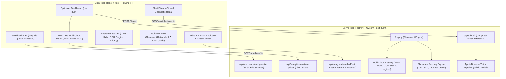

# Multi-Cloud Infrastructure Optimizer & Plant Pathology Diagnostics

A production-grade, end-to-end full-stack MLOps infrastructure control plane and computer vision microservice platform.

---

## 🏛️ System Architecture



---

## 🌟 Key Features

1. **Universal Workload File Upload & Auto-Sizing**:
   - Upload **any** file that requires cloud computing power:
     - Deep learning models (`.pth`, `.pt`, `.onnx`, `.safetensors`, `.bin`, `.h5`, `.keras`, `.joblib`)
     - Model archives & vision datasets (`.zip`, `.tar.gz`)
     - Big data pipelines (`.parquet`, `.csv`, `.arrow`, `.tsv`)
     - Microservice application code (`.py`, `.js`, `.ts`, `Dockerfile`, `compose.yml`)
     - Manifests (`.yaml`, `.json`)
   - The system automatically scans the file, detects the workload category, and **dynamically adjusts recommended resources** (CPU, RAM, GPU, priority, and region).
   - **User Customization Remains Active**: You can still freely fine-tune CPU cores, RAM, GPU toggle, priority, and region using the interactive controls.

2. **Real-Time Multi-Cloud Price Monitoring**:
   - Connects to live price signals across **AWS**, **Microsoft Azure**, and **Google Cloud Platform (GCP)**.
   - Live ticker bar in the UI displaying current hourly rates in ₹ (INR), 24h market delta (+/- %), and active spot discounts.

3. **Interactive Predictive Pricing Trends (Popup Box)**:
   - Dedicated modal popup displaying 12-month time-series:
     - **Historical Prices**: Past 6 months of cloud pricing data.
     - **Current Price**: Highlighted live real-time rate point.
     - **Future Predictive Forecast**: 5-month forward-looking estimate with confidence intervals and algorithmic cost-reduction insights.

4. **Placement Cost Estimation ("Estimate")**:
   - Multi-criteria decision engine evaluating pricing, regional latency (India, US, Europe), SLAs, and green energy metrics to recommend the optimal cloud provider.

5. **Integrated Plant Disease AI Diagnostic Suite (`plant-api`)**:
   - Computer vision model trained on 210 high-resolution leaf images (**Apple Black Rot** vs **Healthy Apple Leaves**) with **96.67% cross-validation accuracy**.
   - Interactive leaf pathology diagnostic modal with one-click test samples and custom leaf upload.

---

## 🚀 Quick Start

### 1. Launch with One Click
Double-click `start_project.bat` in the project root:
- Backend will launch on `http://127.0.0.1:8000`
- Frontend will launch on `http://localhost:3000`
- Interactive API Docs will be available at `http://127.0.0.1:8000/docs`

### 2. Or Launch Individually

#### Backend (FastAPI + Python):
```powershell
cd e:\mce\backend
python run.py
```

#### Frontend (Vite + React):
```powershell
cd e:\mce\frontend
npm.cmd run dev
```

---

## 🧪 Automated Testing

Run the automated test suite with Pytest:
```powershell
cd e:\mce\backend
python -m pytest tests -v
```
All 11 tests pass covering deployment estimation, GPU allocations, smart file analysis, live pricing feeds, and plant pathology inference.
